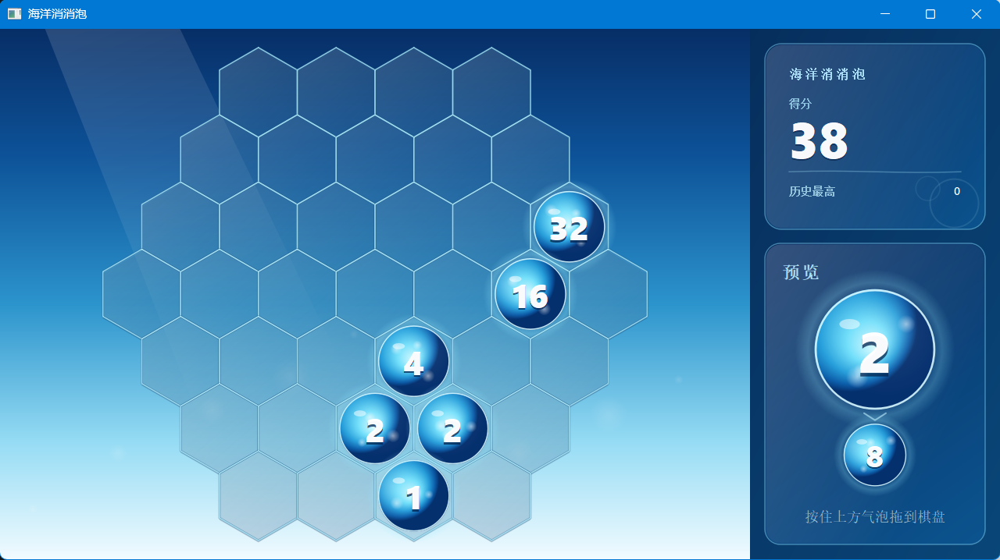

# OceanBubble（海洋消消泡）

Qt Widgets 写的六边形蜂窝「三消合并」小游戏：圆心 + 3 圈蜂窝共 **37 格**，从右侧预览栏拖拽气泡放入棋盘，同数值 3 连消合并升级，连锁每多一跳得分翻倍，最高分用 `QSettings` 持久化。

---

## 1. 目录结构

```
OceanBubble/
├─ CMakeLists.txt          构建脚本（CMake ≥ 3.16）
├─ main.cpp                入口：QApplication + 应用标识 + 主窗口
├─ Theme.h                 全局主题常量（配色、拖拽 MIME、黄金分割比例）
├─ core/
│  ├─ HexGrid.h/.cpp       六角网格几何：轴向坐标、37 格布局、命中检测、邻接关系
│  └─ GameModel.h/.cpp     游戏核心逻辑：放置、连通组查找、连锁合并、计分、最高分存档
├─ ui/
│  ├─ GameWindow.h/.cpp    主窗口：整体布局、棋盘/预览栏/计分板装配、结束弹窗
│  ├─ BoardWidget.h/.cpp   棋盘控件：绘制、拖放接收、动画
│  ├─ PreviewPanel.h/.cpp  预览栏：随机气泡展示与拖拽发起
│  ├─ ScorePanel.h/.cpp    计分板：当前分 / 最高分 / 连锁提示
│  └─ BubblePainter.h/.cpp 气泡绘制（渐变、描边、数值文字）
└─ build/                  构建输出（可随时删除后重建）
```

代码依赖关系：`main` → `ui/GameWindow` → `ui/{BoardWidget, PreviewPanel, ScorePanel}` → `ui/BubblePainter`；`GameModel` 与界面通过 Qt 信号槽解耦，`HexGrid` 只做纯几何计算。

---

## 2. 环境要求

| 项 | 版本 / 路径（本机实测） |
|---|---|
| Qt | **5.15.2 MSVC2019 64-bit** → `D:\tool\QT 5.15.2\5.15.2\msvc2019_64` |
| 编译器 | Visual Studio 2022（工具集 v143，MSVC 19.37） |
| CMake | 3.28.5（最低 3.16） |
| Ninja（可选） | 1.13.2 |
| Qt 模块 | `Core`、`Gui`、`Widgets`（无 QML / 无 Qt Creator / 无第三方库） |

> Qt 路径不同时，把下面命令里的 `CMAKE_PREFIX_PATH` 换成自己的 Qt 安装目录即可。
> 若使用 Qt 6，需要改 `CMakeLists.txt` 里的 `find_package(Qt5 ...)` 与 `Qt5::Widgets`。

---

## 3. 构建（Visual Studio 生成器，推荐）

在工程根目录 `D:\xq\findWork\OceanBubble` 下执行：

### 3.1 配置（首次或修改 CMakeLists.txt 后执行）

```bat
cmake -S . -B build -G "Visual Studio 17 2022" -A x64 "-DCMAKE_PREFIX_PATH=D:/tool/QT 5.15.2/5.15.2/msvc2019_64"
```

### 3.2 编译

```bat
:: Release
cmake --build build --config Release

:: Debug
cmake --build build --config Debug
```

多核并行可追加 `-- /m`：

```bat
cmake --build build --config Release -- /m
```

### 3.3 产物

| 配置 | 可执行文件 |
|---|---|
| Release | `build\Release\OceanBubble.exe` |
| Debug | `build\Debug\OceanBubble.exe` |

配置阶段还会生成 `build\OceanBubble.sln`，可用 VS 2022 直接打开该解决方案（它是 CMake 的生成物，不是手写工程）。

### 3.4 备选：Ninja 构建（需 VS 开发者环境）

```bat
call "C:\Program Files\Microsoft Visual Studio\2022\Community\VC\Auxiliary\Build\vcvars64.bat"
cmake -S . -B build-ninja -G Ninja -DCMAKE_BUILD_TYPE=Release "-DCMAKE_PREFIX_PATH=D:/tool/QT 5.15.2/5.15.2/msvc2019_64"
cmake --build build-ninja
```

产物：`build-ninja\OceanBubble.exe`。

---

## 4. 部署（生成可直接双击运行的目录）

Windows 下 Qt 程序需要 Qt 运行时 DLL。对产物执行一次 `windeployqt` 即可（已部署过则无需重复）。
注意 **必须把 exe 路径作为参数传给 windeployqt**，只写 `--debug` 不会部署任何东西。

**cmd.exe**

```bat
:: Release
"D:\tool\QT 5.15.2\5.15.2\msvc2019_64\bin\windeployqt.exe" --release "build\Release\OceanBubble.exe"

:: Debug（Debug 版依赖 Qt5Cored.dll 等调试库）
"D:\tool\QT 5.15.2\5.15.2\msvc2019_64\bin\windeployqt.exe" --debug "build\Debug\OceanBubble.exe"
```

**PowerShell**

PowerShell 不能直接以带空格的路径开头执行命令，路径必须加引号并用调用符 `&`：

```powershell
# Release
& "D:\tool\QT 5.15.2\5.15.2\msvc2019_64\bin\windeployqt.exe" --release "build\Release\OceanBubble.exe"

# Debug
& "D:\tool\QT 5.15.2\5.15.2\msvc2019_64\bin\windeployqt.exe" --debug "build\Debug\OceanBubble.exe"
```

成功时输出里会有 `Updating Qt5Cored.dll`、`Creating directory .../platforms` 等行。
`Warning: Cannot find Visual Studio installation directory, VCINSTALLDIR is not set` 属正常提示（未在 VS 开发者命令行下运行），不影响部署。

部署后会拷贝 `Qt5Core.dll / Qt5Gui.dll / Qt5Widgets.dll / Qt5Svg.dll`、`platforms\qwindows.dll`、`styles\`、`imageformats\` 等。

---

## 5. 运行命令

方式一（直接运行，DLL 已部署）：

```bat
build\Release\OceanBubble.exe
build\Debug\OceanBubble.exe
```

方式二（DLL 未部署时，临时把 Qt bin 加入 PATH）：

```bat
:: cmd.exe
set PATH=D:\tool\QT 5.15.2\5.15.2\msvc2019_64\bin;%PATH%
build\Debug\OceanBubble.exe
```

```powershell
# PowerShell
$env:PATH = "D:\tool\QT 5.15.2\5.15.2\msvc2019_64\bin;$env:PATH"
.\build\Debug\OceanBubble.exe
```

方式三：资源管理器双击对应的 `OceanBubble.exe`。

运行成功表现：出现标题为「海洋消消泡」的窗口，右侧预览栏可拖拽气泡到棋盘。

---

## 6. 调试

**Visual Studio 2022（F5 断点调试）**

1. 菜单 `文件 → 打开 → CMake`，选择本工程的 `CMakeLists.txt`；
2. VS 读取 `CMakeSettings` 后自动配置，若提示找不到 Qt，在 `CMakePresets`/设置里把 `CMAKE_PREFIX_PATH` 设为 `D:/tool/QT 5.15.2/5.15.2/msvc2019_64`；
3. 工具栏选择目标 `OceanBubble.exe (Debug)`，按 F5。

**打开生成的解决方案调试（等价做法）**

```bat
start build\OceanBubble.sln
```

在 VS 里把 `OceanBubble` 设为启动项目，选择 `Debug` + `x64`，F5。

**命令行调试（可选，需 Windows SDK 调试器）**

```bat
cdb -g -G build\Debug\OceanBubble.exe
```

---

## 7. 工程标识与配置存储

| 项 | 值 |
|---|---|
| 工程 / 可执行文件 | `OceanBubble` |
| 组织名 `OrganizationName` | `xuqi` |
| 应用名 `ApplicationName` | `OceanBubble` |
| 最高分存储位置 | 注册表 `HKEY_CURRENT_USER\Software\xuqi\OceanBubble` |
| 最高分键名 | `score/best` |

> 组织名/应用名改变会改变 `QSettings` 的存储位置，因此历史最高分与旧版 `GameBall4096` 不共用。

---

## 8.运行结果
